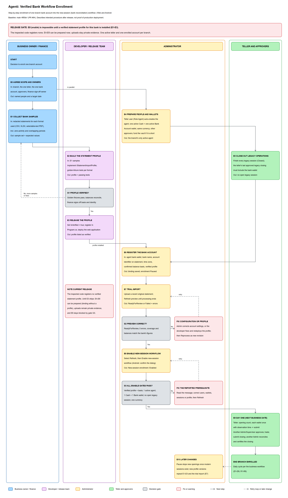

# Agenti: verified bank workflow enrollment guide

## Purpose and scope

This guide is the step-by-step procedure for enrolling one branch's bank account into the verified bank workflow added in PR #94, so that the branch's new cash sessions are reconciled against imported bank statements. It was prepared from the implementation at `main` commit `4ff05e1` and covers the web application, the Android app and the REST API.

**Scope assumption:** this guide takes "enroll a verified bank workflow" to mean making the branch's next sessions start as bank-reconciliation sessions (`SessionWorkflowVersion.BankReconciliation`). That needs three things: a verified statement profile for the bank's file format, an account binding to the teller's bank wallet, and the **Enable new-session workflow** action. Daily operation after enrollment (D1-D9, N1-N2 and R1-R7) is described in [Agenti: customer banking and bank-statement reconciliation](agenti-banking-business-workflow.md).

This is a description of the implementation and its intended operating procedure after release, not confirmation that it is deployed or enabled in production. No production data was accessed to prepare it.

**Release gate:** the application registers a Centenary agency-float XLSX candidate, but it is explicitly unverified. No bank profile can parse statements or pass enable gate 1 until it passes G1 and is released as verified. The **Statements and Accounts** warning remains while no profile is verified:

> No bank-specific importer is verified yet. Representative redacted CSV, Excel and selectable-text PDF samples must be verified before activation. Files can be retained as private evidence; they will not be treated as successfully parsed statements.

Steps E4-E6 can be prepared now.

For the Centenary XLSX candidate's exact preparation, mapping, date-only limitation and additional sample requirements, see [Centenary agency-float XLSX statement profile](centenary-agency-float-statement-profile.md).

Companion files:

- [Editable process diagram](bank-workflow-enrollment-guide.excalidraw).
- [Scalable browser-readable diagram](bank-workflow-enrollment-guide.svg).
- [PNG preview](bank-workflow-enrollment-guide.png).

This guide expands the one-time onboarding steps in section 3 of the business workflow:

| Business workflow step | Steps in this guide |
|---|---|
| A1 - validate the bank-statement format and release readiness | E1, E2, G1 and E3 |
| A2 - register a bank account | E6, prepared by E4 |
| A3 - enable the new-session workflow | E5, E7, G2, E8 and G3 |

E0 (planning), E9 (day one) and E10 (later changes) surround these steps.

## 1. What enrollment changes

| Topic | Behaviour |
|---|---|
| Which sessions change | Only sessions created after enabling. Existing sessions keep their workflow; **Cash Sessions** labels each one "Legacy" or "Bank reconciliation". |
| Routing rule | A branch's new sessions use the bank workflow when the branch has an enabled bank account, or once any bank-reconciliation session has existed for the branch. |
| Daily cycle | The teller's opening needs approval by an Admin or Supervisor. Submitting the closing ends trading and returns the float to the vault once. An Admin later reconciles the bank statement and certifies the closing. The next opening needs only the previous closing to be submitted, not certified. |
| Pausing | Before the first bank-reconciliation session exists, pausing returns the branch to legacy sessions. After that, pausing blocks new openings: the teller sees "Bank workflow enrollment is paused" and "An administrator must configure and verify the bank account before starting a new session." Bank-reconciliation sessions never revert to legacy. |
| Release limits | One active agent (teller) and one enrolled bank account per branch; one Cash wallet and one Bank Account wallet in the account's currency; CSV, XLSX and selectable-text PDF statements only; no OCR; no live connection to the bank. |
| Money | Enrollment itself moves no money. Funds move when an opening is approved (vault to wallets) and when a closing is submitted (float back to the vault). |

## 2. Roles

| Role | Steps | Requirements |
|---|---|---|
| Business owner / finance | E0 and E1; signs off G1 and G2 | Owns the expected statement values and the balance basis. |
| Developer / release team | E2, G1 and E3 | Builds, tests and releases the statement profile. |
| Enrolling Admin | E4, E6, E7, G2, E8 and E10 | Admin role, active, assigned to the branch. |
| Teller | E5 and E9 | Agent role; must be the branch's only active agent. |
| Opening approver | Approves the day-one opening (E9) | Admin or Supervisor; not the teller. |
| Second Admin | Approves a vault deposit (E4), only if one is needed | Not the Admin who requested the deposit. |
| Closing certifier | Reconciles and certifies the closing (E9) | Admin assigned to the branch; not the teller. |

Supervisors can't open bank statements or reconciliation reviews.

## 3. Process diagram



How to read it: each lane is a role (blue: business owner and finance; purple: developer and release team; orange: administrator; green: teller and approvers). Grey boxes are decision gates and red boxes are fixes or warnings. Solid arrows lead to the next step; dashed arrows are retry loops or later changes. E4 runs in parallel with E1-E3, and the account binding (E6) can be saved before a profile exists.

## 4. Before you start

- [ ] Everyone in section 2 is named, and the teller is neither the opening approver nor the closing certifier.
- [ ] The enrolling Admin, the approvers and the teller are active users assigned to the branch.
- [ ] The Admin can download original statements for the account as CSV, XLSX or selectable-text PDF.
- [ ] Finance knows which balance the statement shows (ledger, available or float) and its time zone.
- [ ] The vault can fund the first opening, or a second Admin can approve a vault deposit (E4).
- [ ] The day-one business date is agreed and falls after the last legacy session.

## 5. Steps at a glance

| ID | Actor | Step | Key inputs | Output |
|---|---|---|---|---|
| E0 | Business owner, Admin | Agree scope and owners | Branch, teller, bank account, approvers, sign-off owner | Named people and a day-one date |
| E1 | Finance | Collect bank samples | Original statements in each format | Redacted samples and expected values |
| E2 | Developer | Build the statement profile | E1 samples | Profile and passing golden-fixture tests |
| G1 | Developer, finance | Profile verified? | Test results, finance review | Yes: E3. No: back to E1 or E2 |
| E3 | Release team | Release the profile | Verified profile | Deployed profile, listed as verified |
| E4 | Admin | Prepare people and wallets | Teller, wallets, approvers, vault funds | The only active agent, with Cash and Bank Account wallets |
| E5 | Teller, approvers | Close out legacy operations | Open legacy sessions | No active legacy session |
| E6 | Admin | Register the bank account | Wallet, bank name, identifier, time zone, basis, profile | Binding saved; enrollment Paused |
| E7 | Admin | Trial import | A recent original statement | Preview: ReadyForReview or Failed |
| G2 | Admin, finance | Preview correct? | Preview compared with the bank's figures | Yes: E8. No: fix and reprocess |
| E8 | Admin | Enable the new-session workflow | Refreshed account | "New-session enrollment: Enabled" |
| G3 | Application | Enable gates pass? | Gates 0-5 | Yes: E9. No: fix and retry E8 |
| E9 | Teller, approver, Admin | Day one | Opening, trading, closing, statement | First certified bank-reconciliation closing |
| E10 | Admin, developer | Later changes | Pause, settings, new profile versions | A controlled change |

## 6. Detailed steps

### E0 - Agree scope and owners

Record these decisions before any setup:

| Decision | Guidance |
|---|---|
| Branch | One branch per enrollment. |
| Teller | The one person who will be the branch's only active agent. |
| Bank account | The account whose statements will be reconciled, with its identifier exactly as printed on statements. |
| Currency | The teller's Cash and Bank Account wallets must use this currency. |
| Balance basis | The balance the statement shows: Ledger, Available or Float. |
| Statement time zone | The time zone of the statement's dates (default `Africa/Kampala`). |
| Opening approver | An Admin or Supervisor other than the teller. |
| Closing certifier | An Admin assigned to the branch, other than the teller. |
| Second Admin | Needed only if the vault needs a deposit before day one (E4). |
| Finance sign-off owner | Signs off G1 and G2. |
| Day-one date | A business date after the last legacy session (E5). |

### E1 - Collect bank samples

Download original statements in every format the branch will upload: CSV, XLSX or selectable-text PDF. Scanned or image-only PDFs aren't supported.

Include at least:

- a normal trading period;
- a period with no transactions;
- two periods that overlap;
- reversals and bank fees;
- a multi-page statement, if PDF is used.

Redact consistently: replace names and identifiers with stable placeholders so balances, row counts and transaction numbers still add up. Keep unredacted statements out of the repository.

For each sample, finance records the values the profile must reproduce:

| Expected value | Why it matters |
|---|---|
| Account identifier as printed | Must match the account binding (E6). |
| Currency | Every row must use the account's currency. |
| Balance basis | Must match the profile and the account. |
| Coverage start and end, with time zone | Every row must fall inside the coverage. |
| Opening and closing balances | Opening plus movements must equal closing. |
| Row count, total credits and total debits | Catches dropped or duplicated rows. |
| Running balance after each row | Checked row by row. |
| Whether transaction numbers are unique and stable across overlapping statements | Decides whether the profile can return a reliable identity. |
| Timestamp precision (date only, or date and time) | Sets `HasPreciseTimestamp`. |

**Date-only timestamps are a release blocker for this reconciliation workflow.** A row assigned only to a business date cannot establish a precise session cutoff balance or the midnight coverage bridge on an active day. Require a timed bank export or an approved, tested engine change before signing off a date-only profile; never fabricate times. For the current Centenary candidate, see the [profile-specific limitation and options](centenary-agency-float-statement-profile.md#status-and-release-gate).

### E2 - Build the statement profile

A statement profile is a C# class that implements `IStatementImportProfile` (`EastSeat.Agenti.Web\Features\BankStatements\StatementProfile.cs`). Each account uses one profile, so the profile must list every content type the branch will upload.

| Member | Meaning |
|---|---|
| `string Key` | Stable, unique key saved on the account, such as `example-bank-csv`. Duplicate keys make the profile catalog fail to load. |
| `string BankIdentifier` | Identifies the bank. Saving the profile on an account copies it to the account, and imports only use a profile with the same identifier. |
| `string DisplayName` | Shown in profile lists, which are sorted by this name. |
| `int Version` | Increase it whenever parsing changes. |
| `bool IsVerified` | `true` only after G1. An unverified profile can't parse uploads or pass enable gate 1. |
| `BankBalanceBasis BalanceBasis` | `Ledger`, `Available` or `Float`. |
| `IReadOnlyList<string> SupportedContentTypes` | Any of `text/csv`, `application/vnd.openxmlformats-officedocument.spreadsheetml.sheet` and `application/pdf`. |
| `ParseAsync(source, contentType, account, cancellationToken)` | Returns a `ParsedStatement`. Throw `StatementParsingException` when the layout can't be read. |
| `GetReliableIdentity(entry)` | Returns a unique, stable bank identity for a row, or `null` when the bank's numbers can't be trusted. |

`ParsedStatement` contains:

| Field | Content |
|---|---|
| `AccountIdentifier`, `Currency`, `BalanceBasis` | As shown on the statement. |
| `CoverageFrom`, `CoverageTo` | The statement period. Each row's ledger time must be at or after `CoverageFrom` and before `CoverageTo`. |
| `OpeningBalance`, `ClosingBalance` | The statement balances. |
| `CompleteCoverage` | `true` only when the profile has established that the whole period is present. |
| `Entries` | One `ParsedStatementEntry` per row. |

`ParsedStatementEntry` contains:

| Field | Content |
|---|---|
| `SourceLocation` | Where the row came from, such as a row number or a page and line. Required. |
| `RawData` | The original row text. |
| `TransactionNumber`, `Reference`, `CustomerIdentifier` | As printed; keep leading zeros. |
| `Narration` | The description text. |
| `Currency` | The row's currency. |
| `SignedAmount` | Positive for credits, negative for debits. |
| `RunningBalance` | The balance after this row. It's required: if the bank doesn't print it, compute it from the opening balance and the earlier rows. |
| `OccurredAt`, `PostedAt`, `ValueDate` | Transaction time, posting time (optional) and value date (optional). The ledger time is `PostedAt` when present, otherwise `OccurredAt`. |
| `HasPreciseTimestamp` | `true` when the bank gives a time, not only a date. |

Each parsed statement is validated. These are the rules and the messages they produce:

| Rule | Message |
|---|---|
| The statement identifier matches the account | "The statement account identity does not match the selected bank account." |
| Currency and basis match the account | "The statement currency or balance basis does not match the configured account." |
| The profile established complete coverage | "Complete statement coverage has not been established by the bank profile." |
| The period and balances are valid | "A valid statement interval and opening/closing balances are required." |
| Each row uses the account's currency | "Row {n} uses a different currency." |
| Each row is inside the coverage | "Row {n} falls outside the declared statement coverage." |
| Rows are in ledger order | "Row {n} is out of ledger order." |
| Running balances follow the amounts | "The running balance does not reconcile at row {n}." |
| Opening plus movements equals closing | "The statement opening balance plus its movements does not equal its closing balance." |
| Header balances, account details and coverage are usable (checked during processing) | "The statement header has invalid balances, account metadata, or unsupported/future coverage." |

Field limits: `Currency` is 3 characters; `SourceLocation` is required and at most 256 characters; `TransactionNumber`, `Reference` and `CustomerIdentifier` are at most 256; `Narration` is at most 4,000; `RawData` is at most 16,384; amounts have at most 2 decimal places.

Default processing limits (section 10): 10,000 rows per statement, 120 seconds per import and 5,242,880 bytes per file.

Parser libraries: the Centenary candidate uses a bounded reader built on .NET `ZipArchive` and `XmlReader`; it does not evaluate formulas or follow external workbook links. For other bank layouts, choose a maintained parser and review its licence. Don't use OCR, run macros or send statements to outside services.

**Skeleton** (`EastSeat.Agenti.Web\Features\BankStatements\ExampleBankCsvStatementProfile.cs`; the names and values are placeholders):

```csharp
using System.Text;
using EastSeat.Agenti.Shared.Domain.Enums;

namespace EastSeat.Agenti.Web.Features.BankStatements;

public sealed class ExampleBankCsvStatementProfile : IStatementImportProfile
{
    public string Key => "example-bank-csv";
    public string BankIdentifier => "EXAMPLEBANK";
    public string DisplayName => "Example Bank CSV statement";
    public int Version => 1;

    // Set to true only after golden fixtures pass and finance signs off (G1).
    public bool IsVerified => false;

    public BankBalanceBasis BalanceBasis => BankBalanceBasis.Ledger;
    public IReadOnlyList<string> SupportedContentTypes => ["text/csv"];

    public async Task<ParsedStatement> ParseAsync(
        Stream source, string contentType, StatementAccountContext account, CancellationToken cancellationToken)
    {
        using var reader = new StreamReader(source, Encoding.UTF8, detectEncodingFromByteOrderMarks: true, leaveOpen: true);
        var text = await reader.ReadToEndAsync(cancellationToken);

        // Parse the header and rows from text, reading bank dates in account.TimeZoneId.
        // Throw StatementParsingException for an unreadable layout; never return partial data.
        throw new StatementParsingException("The Example Bank CSV layout has not been implemented.");
    }

    // Return null instead if E1 showed the bank's transaction numbers aren't unique and stable.
    public string? GetReliableIdentity(ParsedStatementEntry entry) =>
        string.IsNullOrWhiteSpace(entry.TransactionNumber) ? null : entry.TransactionNumber.Trim();
}
```

**Registration**, next to the catalog at `EastSeat.Agenti.Web\Program.cs:176`:

```csharp
builder.Services.AddSingleton<IStatementImportProfile, ExampleBankCsvStatementProfile>();
```

Profiles are singletons, so they must be stateless and thread-safe.

**Golden-fixture test**, one per sample and format (`tests\EastSeat.Agenti.UnitTests\BankReconciliation\ExampleBankCsvStatementProfileTests.cs`):

```csharp
using EastSeat.Agenti.Shared.Domain.Enums;
using EastSeat.Agenti.Web.Features.BankStatements;

namespace EastSeat.Agenti.UnitTests.BankReconciliation;

public class ExampleBankCsvStatementProfileTests
{
    [Fact]
    public async Task January2025Statement_MatchesFinanceExpectedValues()
    {
        var profile = new ExampleBankCsvStatementProfile();
        var account = new StatementAccountContext("0123456789", "UGX", "Africa/Kampala", BankBalanceBasis.Ledger);
        await using var source = File.OpenRead(Path.Combine("Fixtures", "ExampleBank", "statement-2025-01.csv"));

        var statement = await profile.ParseAsync(source, "text/csv", account, CancellationToken.None);

        Assert.True(statement.CompleteCoverage);
        Assert.Equal("0123456789", statement.AccountIdentifier);
        Assert.Equal(statement.ClosingBalance, statement.OpeningBalance + statement.Entries.Sum(e => e.SignedAmount));
        // Also assert finance's expected coverage, balances, row count, totals and running balances from E1.
    }
}
```

Put the redacted fixtures under `tests\EastSeat.Agenti.UnitTests\Fixtures\` and copy them to the test output by adding this to `tests\EastSeat.Agenti.UnitTests\EastSeat.Agenti.UnitTests.csproj`:

```xml
<ItemGroup>
  <None Include="Fixtures\**\*" CopyToOutputDirectory="PreserveNewest" />
</ItemGroup>
```

Run the profile's tests:

```powershell
dotnet test tests\EastSeat.Agenti.UnitTests\EastSeat.Agenti.UnitTests.csproj --filter "FullyQualifiedName~ExampleBankCsvStatementProfile"
```

With the skeleton unchanged, this test fails with "The Example Bank CSV layout has not been implemented." That is expected; it passes once the parser is implemented.

For a working example of the mechanics, see `SyntheticStatementProfile` in `tests\EastSeat.Agenti.IntegrationTests\Infrastructure\BankingApplicationFactory.cs`. It reads a test-only JSON format (key `synthetic-test-json-not-bank-format`); never register it in the application.

### G1 - Profile verified?

Pass only when all of these hold:

- The golden-fixture tests pass for every sample and format.
- Each statement's opening balance plus its movements equals its closing balance, and every running balance reconciles.
- The identifier, currency, basis, coverage, row count and totals equal finance's expected values.
- Timestamp precision supports session cutoffs and overnight coverage; unresolved date-only activity blocks approval.
- Credits are positive and debits negative.
- Reliable identities are unique across overlapping samples, or the profile returns `null`.
- Unreadable or damaged files throw `StatementParsingException` and never return partial data.
- Finance signs off the balance basis and the account identity.

If a check fails, go back to E1 for missing samples or expected values, or to E2 for parsing fixes.

### E3 - Release the profile

1. Set `IsVerified => true`, keep the registration and merge through a reviewed pull request.
2. Deploy the web application through the normal pipeline ([CI/CD pipeline](CI_CD_PIPELINE.md)).
3. Sign in as the enrolling Admin and open **Bank Reconciliation** > **Statements and Accounts**. The profile is marked verified. Over the API, `GET /api/banking/admin/accounts/setup` lists it with `isVerified: true`.
4. If the account was bound while this profile was unverified, edit **Account configuration**, select the now-verified profile, and **Save configuration** again. The account's verified-profile flag is captured on save; deployment alone does not update it.

### E4 - Prepare people and wallets

E4 can start as soon as E0 is agreed, in parallel with E1-E3.

**a. Teller.** If the teller has no user account, go to **Administration** > **Users** > **Create User**. In "Create New User", enter First Name, Last Name, Email, Phone Number (Optional), Branch, and Role **Agent**. Creating an Agent user also creates the agent record, so don't use **Add Agent** for this person. The confirmation shows "User created successfully. Temporary password: {password}"; give the password to the teller securely.

**b. One active agent.** Under **Administration** > **Agents**, deactivate every other active agent in the branch, including agent records linked to Admin or Supervisor users. Gate 2 counts them all.

**c. Wallets.** Open the teller from **Agents** and use **Add Wallet** for any wallet that's missing. Wallet balances are filled from the vault when an opening is approved, so new wallets start at 0.

| Wallet Type | Wallet Name | Currency | Initial Balance | Active |
|---|---|---|---|---|
| Cash | For example "Teller cash" | The bank account's currency | 0 | Yes |
| Bank Account | For example "Example Bank float" | The bank account's currency | 0 | Yes |

- An agent can have one wallet of each type, inactive ones included ("Agent already has a wallet of type '{name}'."). Reactivate an existing wallet instead of adding another.
- Keep only these two wallets active if you can. Any other active wallet must use the same currency, and the teller must count it at every opening and closing.
- If the teller has legacy history, create the Bank Account wallet before their final legacy closing (E5).

**d. Approvers.** Make sure an Admin or Supervisor other than the teller can approve openings (**Vault** > **Approvals**), and an Admin assigned to the branch, other than the teller, can certify closings.

**e. Vault funding for day one.** Approving the first opening withdraws float from the vault:

| Teller's history | The vault supplies |
|---|---|
| An earlier closing exists (an approved legacy closing or a submitted bank-reconciliation closing) | The opening total, minus the bank balance's change since that closing (the observed opening bank balance minus the bank balance in that closing). The closing must include the Bank Account wallet. |
| No earlier closing | The full opening total, including the bank balance. |

If the vault is short, approval fails with "Insufficient balance in vault." To add funds, open **Vault**, select **Request Manual Adjustment**, choose "Deposit (Add to Vault)", enter the amount and notes of at least 10 characters, and select **Submit Request**. The page confirms "Adjustment request submitted for approval." A second Admin must approve it under **Pending Approvals** with **Approve** within 12 hours, or it expires.

### E5 - Close out legacy operations

1. Finish every legacy session: the teller submits the closing count and an approver approves it. If a legacy session still shows Open after all its closing counts are approved, use **Close Session** on **Cash Sessions**; the button appears only for those sessions.
2. If the teller has legacy history, their final approved legacy closing must include the Bank Account wallet. Otherwise day-one opening approval fails with "The bank account has no prior closing observation. Its opening allocation needs admin setup."
3. Pick a day-one date after the last legacy session. A branch has one session per date, and openings always use today's date.
4. If enrollment slips and someone opens another legacy session, finish it before E8.

Gate 4 blocks enabling while a legacy session is active: "Finish active legacy sessions before enabling the new workflow."

### E6 - Register the bank account

**Web:** open **Bank Reconciliation** > **Statements and Accounts** (`/bank-statements`). The page shows "Register the existing agent bank wallet to begin. This does not move money or change legacy sessions." Expand **Register a bank account** and fill in:

| Field | Enter | Rules |
|---|---|---|
| Agent bank wallet | The teller's Bank Account wallet | An active bank wallet in this branch that isn't already bound. The binding can't move to another wallet later. |
| Bank name | For example `Example Bank` | Required; up to 200 characters. |
| Account identifier shown on statement | Exactly as printed, for example `0123456789` | Required; up to 256 characters; leading zeros are kept. Statements must show the same identifier. |
| Statement time zone | `Africa/Kampala`, unless finance says otherwise | Must be a valid time zone. |
| Confirmed balance basis | Ledger, Available or Float | Must match the profile. "Unverified" can be saved but blocks enabling. |
| Statement profile | The profile released in E3 | Optional now; needed for E7 and E8. Unverified choices are labeled **(not verified)** and cannot process statements or enable the workflow. |

Select **Save account binding**. The account then shows "New-session enrollment: Paused". Its currency comes from the wallet.

To change the settings later, select **Refresh**, choose the account under **Bank account**, edit **Account configuration** and select **Save configuration**.

**Android:** open **Bank statements** from the menu and tap **Configure a bank account**. Fill in "Bank wallet", "Bank name", "Bank account identifier", "Bank timezone identifier", "Balance basis" and "Import profile", then tap **Save account configuration**, or **Keep draft and return** to finish later. Unverified profiles are labeled **(not verified)**. To change the settings later, tap **Edit: {bank name}**. Until an account exists, the list shows "No bank accounts configured. Link the branch's bank wallet first." When no verified profile is installed, the form shows "No verified production import profiles are installed. Original files can still be retained privately."

| Message | Fix |
|---|---|
| "Select an active bank wallet in this branch." | Activate the teller's Bank Account wallet (E4c), or check your branch assignment. |
| "This wallet already has a bank account binding." | The account already exists; select it under **Bank account**. |
| "Enter a bank name and account identifier within the supported lengths." | Fill in both, within 200 and 256 characters. |
| "Choose a supported balance basis." | Choose Ledger, Available or Float. |
| "Select a valid bank statement time zone." or "The selected time zone is invalid." | Use a valid time zone identifier, such as `Africa/Kampala`. |
| "The selected bank statement profile is not installed." | Release the profile (E3), or choose an installed one. |
| "The statement profile and the entered bank balance use different bases." | Choose the basis the profile uses. |
| "A bank account's wallet binding cannot be reassigned." | A binding stays on its wallet. |
| "A statement profile cannot change this account's bank identity." | The account belongs to a different bank and is enabled or has history (E10). |
| "Pause enrollment before removing a verified statement profile." | Pause first (E10). |
| "Account identity, time zone and balance basis cannot be rewritten after financial activity." | These settings are locked once the account has customer transactions or a committed import. |

### E7 - Trial import

Prove the profile works on a real, current statement before enabling.

For the Centenary candidate, use only the original, unedited XLSX. Since **Date To** is inclusive and coverage ends at midnight after that date in the account time zone, generate and download the report only after the next day has begun. Delaying import of a report generated earlier does not establish full-day coverage. This timing does not resolve the candidate's separate date-only timestamp blocker.

1. Download a recent original statement from the bank. Don't open and re-save it in Excel or another editor.
2. **Web:** on **Statements and Accounts**, choose the account under **Bank account**. In **Upload the bank's source file**, choose the file and select **Upload and prepare preview**.
3. In the imports table, select **Review** for the new import, then **Refresh preview** until the status is ReadyForReview or Failed. As the preview says: "Processing is server-side. Refresh this preview to retrieve its durable status."
4. Don't select **Commit reviewed bank entries** unless finance wants that period in Agenti's bank history. The first commit locks the account identifier, time zone and balance basis.

**Android:** on **Bank statements**, open the account's **Statements: {bank name}**, tap **Upload original statement** and pick the file, then tap **Start staged import**. Use **Refresh processing status**, then **Preview import {id}** and **Refresh preview**.

Things to know:

- Without a usable verified profile, the import is created with status Failed and the message "No verified profile supports this bank and file format. Verify representative bank samples before parsing or activation." The file is kept as private evidence and no bank entries are created.
- Starting an import for a file that was already imported returns the existing import. To parse it again after a fix, use **Reprocess as new revision** on the web. Android offers **Reprocess with the verified profile** only for Failed imports.
- "This source file is already queued or being processed." means the earlier run hasn't finished; refresh and wait.
- Starting an import changes the account's version. Select **Refresh** before **Save configuration** or **Enable new-session workflow**, or they fail with "The account configuration changed. Refresh and retry."

| Upload message | Fix |
|---|---|
| "Upload a CSV, XLSX, or PDF statement. Its bank layout must also pass import validation." | Use one of the supported formats. |
| "The file exceeds the 5,242,880-byte upload limit." | Download a shorter period. |
| "An empty file cannot be uploaded as evidence." | Download the statement again. |
| "A valid filename is required." | Upload the file under its original name and extension. |

### G2 - Preview correct?

Pass when the import is ReadyForReview with no validation errors, and finance confirms that the coverage, opening and closing balances, row count, totals, credit and debit directions, and times match the bank statement.

| Problem | Fix |
|---|---|
| Wrong identifier, time zone or basis on the account | While the account is paused and has no history: **Refresh**, edit **Account configuration**, select **Save configuration**, then **Reprocess as new revision** on the web. |
| One row extracted wrongly | In the preview, select **Correct extraction** on the row, enter the corrected values and a "Correction reason", then select **Save normalization correction**. On Android, tap **Correct row {id}**, then **Append corrected extraction**. The original file and extraction are kept. |
| A layout or parsing bug | The developer fixes the profile, increases `Version` and releases it (G1, E3). Then select **Reprocess as new revision**. |

If the same correction is needed on every statement, fix the profile rather than correcting rows.

### E8 - Enable the new-session workflow

**Web:** select **Refresh**, choose the account under **Bank account** and select **Enable new-session workflow**. There's no confirmation dialog. The status changes to "New-session enrollment: Enabled".

**Android:** on **Bank statements**, tap **Enable new-session workflow** for the account and confirm the **Workflow enrollment** dialog.

### G3 - Enable gates

The gates are checked in this order and the first failure is reported. Fix it, select **Refresh** and enable again. Pausing has no gates.

| Gate | Requirement | Message | Fix |
|---|---|---|---|
| 0 | The screen has the account's current version | "The account configuration changed. Refresh and retry." (HTTP 409) | Select **Refresh**. |
| 1 | A verified profile is saved on the account, and the account's basis is confirmed and matches it | "Enrollment requires a verified bank profile and a confirmed matching balance basis. Representative bank samples are required." | Release the profile (E3), then save it with the matching basis (E6). |
| 2 | Only one active agent and one enrolled bank account in the branch | "This release supports one active agent and one enrolled bank account per branch." | E4b. |
| 3 | One active Bank Account wallet and one active Cash wallet | "Initial enrollment requires one active bank wallet and one active cash wallet." | E4c. |
| 4 | No active legacy session | "Finish active legacy sessions before enabling the new workflow." | E5. |
| 5 | The agent's wallets use the bank account's currency | "The enrolled agent's wallets must use the bank account currency." | E4c. |

### E9 - Day one

| # | Who | Action | Result |
|---|---|---|---|
| 1 | Teller | In **Cash Count**, count every active wallet once with its observation time, and submit the opening (business workflow D1-D2). | "Opening count awaiting approval" |
| 2 | Admin or Supervisor, not the teller | Approve the opening under **Vault** > **Approvals** (D3). | The vault funds the wallets; "Session open". |
| 3 | Teller | Record customer transactions and bank runs (D4-D7). | Expected balances update. |
| 4 | Teller | Enter and submit the closing count (D8-D9). | Trading ends and the float returns to the vault once; "Session ended; awaiting admin approval". |
| 5 | Admin, not the teller | Import the day's statement, reconcile and certify the closing (R1-R6). | "Session ended; closing approved" |

If the previous closing was a legacy closing, the first review includes this expected note: "The initial bridge from legacy history has no verified old observation timestamp; historical coverage remains explicitly incomplete."

The next day's opening only needs today's closing to be submitted; certification can come later. If the approver rejects an opening, it returns to draft so the teller can correct and resubmit it.

| Message | Meaning and fix |
|---|---|
| "A verified, enabled bank workflow is required to start this session." | The account isn't enabled, or its profile isn't verified. Check E8 and the profile. |
| "Bank workflow enrollment is paused" | An Admin paused enrollment. Re-enable it (E10). |
| "New opening counts must use today's business date; future counts are not permitted." | Count on the day itself. |
| "Submit the previous session's closing before starting another session." | Submit the earlier closing first. |
| "Count each allocated active wallet exactly once." | Include every active wallet once. |
| "Enter valid observation times and two-decimal wallet amounts; cash cannot be negative." | Correct the times and amounts. |
| "Only administrators or supervisors can approve opening counts." | Ask an Admin or Supervisor. |
| "You cannot approve your own opening count." | Someone else approves. |
| "Insufficient balance in vault." | Fund the vault (E4e) and approve again. |
| "The opening observation must follow the prior closing observation." | The bank observation time must be later than the previous closing's. |
| "The bank account has no prior closing observation. Its opening allocation needs admin setup." | The teller's previous closing didn't include the Bank Account wallet (E5). There's no in-app fix; escalate to the implementation team. |
| "The opening count must be approved before closing." | Wait for the opening approval. |
| "Closing wallet balances differ from recorded movements. Provide an explanation for admin review." | Enter an explanation; the Admin reviews it. |
| "You cannot certify your own closing." | Another Admin certifies. |

### E10 - Later changes

| Change | How | Limits |
|---|---|---|
| Pause new enrollment | Web: **Pause new enrollment**. Android: **Stop new workflow enrollment**. | Once bank-reconciliation sessions exist, pausing blocks new openings. It never turns sessions back into legacy ones. |
| Re-enable | **Enable new-session workflow** | The G3 gates apply again. |
| Change the account identifier, time zone or basis | **Save configuration** | Only while paused, and before any customer transactions or committed import. |
| Switch to another bank's profile | **Save configuration** | The same limits as the row above. |
| Remove the profile | **Save configuration** without a profile | Pause first. |
| Bind the account to a different wallet | Not possible | "A bank account's wallet binding cannot be reassigned." |
| The bank changes its statement layout | Repeat E1-E3 to release a new profile `Version`, then repeat E7 and G2. | If an import shows "The verified profile version used by this import is not available.", reprocess it. |
| Add a second teller or bank account | Not supported in this release | Gate 2. |

## 7. Troubleshooting

Enable messages are in G3 and day-one messages are in E9.

| Message | Where | Cause | Fix |
|---|---|---|---|
| "No bank-specific importer is verified yet." (start of the release-gate warning) | Statements and Accounts | No verified profile is installed. | E1-E3. |
| "A branch assignment is required for banking operations." | Any banking screen | The user has no branch. | Assign the user to the branch. |
| "You do not have access to this bank account." | Account or import screens | The account belongs to another branch. | Use an Admin assigned to the account's branch. |
| "Only administrators can access bank statements." | Android | The user isn't an Admin. | Sign in as an Admin. |
| "You do not have permission to access this banking resource." | API (403) | The role or branch doesn't allow the request. | Use an Admin token for admin routes. |
| "No verified profile supports this bank and file format. Verify representative bank samples before parsing or activation." | Failed import | No verified profile on the account, a different bank, or an unsupported file type. | E3 and E6, then **Reprocess as new revision**. |
| "The verified profile no longer agrees with the account or source file." | Failed import | The account's profile or settings changed after the import started. | **Refresh**, then **Reprocess as new revision**. |
| "This source file is already queued or being processed." | Starting an import | The same file is still in progress. | Refresh and wait. |
| "The statement exceeds the configured row limit. Export a smaller interval." | Failed import | More rows than the configured limit (10,000 by default). | Export a shorter period. |
| "Statement processing exceeded its configured time limit." | Failed import | Processing took longer than the configured limit (120 seconds by default). | Export a shorter period. |
| "The statement header has invalid balances, account metadata, or unsupported/future coverage." | Failed import | Unusable header values, or a period that ends in the future. | Check the account settings and the file; otherwise fix the profile. |
| "The source repeats a supposedly unique bank identifier. The bank profile needs review; no financial rows were committed." | Failed import | `GetReliableIdentity` returned the same identity twice. | Fix the profile (E2). |
| "Statement processing failed. The original source is retained; no financial import was committed." | Failed import | Processing failed unexpectedly. | Check the file and the profile, then reprocess. |
| "The verified profile version used by this import is not available." | Failed import | The profile version changed. | **Reprocess as new revision**. |
| "This upload request identity was already used for different content." | API upload | An `uploadKey` was reused for another file. | Use a new GUID for each file. |
| "Notes must be provided (minimum 10 characters) for audit." | Vault adjustment | The notes are too short. | Write at least 10 characters. |
| "Creator cannot approve their own transaction." | Vault adjustment | Self-approval. | A second Admin approves. |
| "Transaction has expired." | Vault adjustment | Not approved within 12 hours. | Submit a new request. |

## 8. Go-live checklist

- [ ] G1 is signed off, and the profile is released and listed as verified (E3).
- [ ] The teller is the branch's only active agent, with active Cash and Bank Account wallets in the account's currency (E4).
- [ ] An opening approver and a closing certifier other than the teller are available on day one.
- [ ] The vault can fund the first opening (E4e).
- [ ] No legacy session is active, and the teller's final legacy closing (if any) included the Bank Account wallet (E5).
- [ ] The account binding has the right identifier, time zone, basis and profile (E6).
- [ ] The trial import is ReadyForReview with no errors, and finance has signed it off (G2).
- [ ] The account shows "New-session enrollment: Enabled" (E8).

## 9. API reference

The Android app and other API clients use JWT bearer tokens. Sign in with `POST /api/auth/login` and a JSON body containing `email` and `password`. The response is an `ApiResponse` (`success`, `data`, `error`): `data.accessToken` is the token, `data.tokenType` is `Bearer` and `data.expiresIn` is its lifetime. Send `Authorization: Bearer {token}` with every banking request. Routes under `/api/banking/admin` require an Admin.

| Step | Request | Body and response |
|---|---|---|
| Any | `GET /api/banking/capabilities` | Returns `contractVersion`, `maximumEvidenceBytes` and `businessTimeZone`. |
| E3, E6 | `GET /api/banking/admin/accounts/setup` | Returns the bank wallets and profiles (with `isVerified`). |
| E6 | `POST /api/banking/admin/accounts` | The account body below. |
| E6, E8 | `GET /api/banking/admin/accounts` | Returns accounts with `version`, `profileVerified` and `workflowEnabled`. |
| E6, G2, E10 | `POST /api/banking/admin/accounts/{id}/configure` | `{ "account": { ... }, "expectedVersion": 3 }` |
| E7 | `POST /api/banking/evidence` | Multipart upload (below). |
| E7 | `POST /api/banking/admin/imports` | `{ "bankAccountId": 7, "evidenceFileId": 42, "reprocess": false }` |
| E7 | `GET /api/banking/admin/accounts/{accountId}/imports` | Lists the account's imports. |
| E7, G2 | `GET /api/banking/admin/imports/{id}` | Returns the import's status and preview. |
| G2 | `POST /api/banking/admin/imports/{id}/rows/{rowId}` | A row correction. |
| Optional | `POST /api/banking/admin/imports/{id}/commit` | Commits the reviewed entries. |
| E8, E10 | `POST /api/banking/admin/accounts/{id}/workflow` | `{ "enabled": true, "expectedVersion": 4 }` |

`expectedVersion` is the account's current `version`. The account body:

```json
{
  "walletId": 12,
  "bankName": "Example Bank",
  "accountIdentifier": "0123456789",
  "timeZoneId": "Africa/Kampala",
  "balanceBasis": 1,
  "importProfileKey": "example-bank-csv"
}
```

Enum values are numbers. `balanceBasis`: 0 Unverified, 1 Ledger, 2 Available, 3 Float. Import `status`: 0 Uploaded, 1 Processing, 2 ReadyForReview, 3 Failed, 4 Committed.

Signing in and uploading a statement from PowerShell (replace `https://localhost:7001`, the local development address, with your deployment's address):

```powershell
$cred = Get-Credential  # the enrolling Admin's email and password
$login = Invoke-RestMethod -Method Post -Uri "https://localhost:7001/api/auth/login" `
  -ContentType "application/json" `
  -Body (@{ email = $cred.UserName; password = $cred.GetNetworkCredential().Password } | ConvertTo-Json)
$token = $login.data.accessToken

$uploadKey = [guid]::NewGuid()
curl.exe -X POST "https://localhost:7001/api/banking/evidence" `
  -H "Authorization: Bearer $token" `
  -F "bankAccountId=7" `
  -F "uploadKey=$uploadKey" `
  -F "isStatement=true" `
  -F "file=@statement-2025-01.csv"
```

Use a new `uploadKey` for each file, and reuse it only to retry the same upload. The response's `data.id` is the `evidenceFileId` for `POST /api/banking/admin/imports`. The server determines the content type itself.

| Status | Meaning |
|---|---|
| 400 | Invalid input: the rule's message, "The request contains an invalid value." or "The request body is invalid." |
| 401 | The token is missing or expired. |
| 403 | "You do not have permission to access this banking resource." |
| 409 | A business rule or a stale version: the rule's message, or "A concurrent request changed this record. Refresh and retry using the same request identity." |
| 413 | "The upload exceeds the configured request size limit." or "The evidence upload exceeds the configured size limit." |
| 500 | "The banking operation could not be completed. Refresh its status before retrying." |

## 10. Configuration

There is no `Banking` section in `appsettings.json`. These defaults come from code and are bound in `EastSeat.Agenti.Web\Program.cs:174-175`.

| Setting | Default | Purpose |
|---|---|---|
| `Banking:Evidence:MaxFileBytes` | 5242880 | Largest evidence file accepted, in bytes. |
| `Banking:Statements:MaximumRows` | 10000 | Most rows in one statement. |
| `Banking:Statements:ProcessingTimeoutSeconds` | 120 | Longest processing time for one import. |
| `Banking:Statements:LeaseSeconds` | 300 | How long a processing lease lasts. |

As environment variables, use double underscores, for example `Banking__Statements__MaximumRows=10000`.

## 11. Implementation traceability

| Topic | Sources (line ranges) |
|---|---|
| Profile contract and catalog | `EastSeat.Agenti.Web\Features\BankStatements\StatementProfile.cs` (1-45) |
| Statement validation | `EastSeat.Agenti.Web\Features\BankStatements\StatementValidation.cs` (18-66) |
| Account registration, configuration and enable gates | `EastSeat.Agenti.Web\Features\BankStatements\BankAccountService.cs` (14-35, 37-73, 75-118, 120-166, 168-200); `EastSeat.Agenti.Web\Features\BankStatements\BankAccountDtos.cs` (5-33) |
| Imports, processing and commit | `EastSeat.Agenti.Web\Features\BankStatements\BankStatementService.cs` (26-70, 119-255, 268-282); `EastSeat.Agenti.Web\Features\BankStatements\BankStatementService.Commit.cs` (62-265, 284-288); `EastSeat.Agenti.Web\Features\BankStatements\BankStatementDtos.cs` (5-70) |
| Evidence upload | `EastSeat.Agenti.Web\Features\BankStatements\BankEvidenceService.cs` (14-116); `EastSeat.Agenti.Web\Features\BankStatements\BankEvidenceDtos.cs` (3-12) |
| Session routing, pausing, openings and closings | `EastSeat.Agenti.Web\Features\CashCounts\BankSessionWorkflow.cs` (14-17, 28-116, 186-262, 361-393, 404-410) |
| Vault funding and opening bridge | `EastSeat.Agenti.Web\Shared\Services\SessionSettlementService.cs` (22-135, 190-250); `EastSeat.Agenti.Web\Features\Vault\VaultService.cs` (77-92, 148, 200-248, 361-424) |
| Access checks | `EastSeat.Agenti.Web\Shared\Services\BankingAccessService.cs` (9-67); `EastSeat.Agenti.Web\Features\BankReconciliation\BankingRequests.cs` (9-11) |
| API routes, errors and sign-in | `EastSeat.Agenti.Web\Features\Api\BankingEndpoints.cs` (14-21, 115-176, 180-209); `EastSeat.Agenti.Web\Features\Api\BankingApiExceptionFilter.cs` (14-55); `EastSeat.Agenti.Web\Features\Api\AuthEndpoints.cs` (19); `EastSeat.Agenti.Web\Features\Api\AuthDtos.cs` (6-37); `EastSeat.Agenti.Web\Program.cs` (174-176, 212-215, 386-392) |
| Users, agents and wallets | `EastSeat.Agenti.Web\Features\Users\UserService.cs` (66-142); `EastSeat.Agenti.Web\Features\Agents\AgentService.cs` (93-140, 282-405) |
| Web screens | `EastSeat.Agenti.Web\Components\Pages\BankStatements.razor` (14-167); `EastSeat.Agenti.Web\Components\Pages\BankReconciliation.razor` (1-184); `EastSeat.Agenti.Web\Components\Pages\Users.razor` (20, 66-114, 208); `EastSeat.Agenti.Web\Components\Pages\Agents.razor` (141-221); `EastSeat.Agenti.Web\Components\Pages\AgentDetail.razor` (110-230); `EastSeat.Agenti.Web\Components\Pages\Vault.razor` (45-121); `EastSeat.Agenti.Web\Components\Pages\VaultAdjustment.razor` (1-131); `EastSeat.Agenti.Web\Components\Pages\CashSessions.razor` (53-111); `EastSeat.Agenti.Web\Components\Pages\CashCountApprovals.razor` (1-7, 102-118); `EastSeat.Agenti.Web\Components\Layout\NavMenu.razor` (7-81) |
| Android screens | `EastSeat.Agenti.Android\AppShell.xaml` (29-33); `EastSeat.Agenti.Android\Pages\BankStatementsPage.cs` (16-205) |
| Test examples | `tests\EastSeat.Agenti.IntegrationTests\Infrastructure\BankingApplicationFactory.cs` (53, 89-104); `tests\EastSeat.Agenti.UnitTests\BankReconciliation\BankStatementTests.cs` (16-37) |

Paths are repository-relative. These are the inspected implementation sources, not proof of a production deployment.
